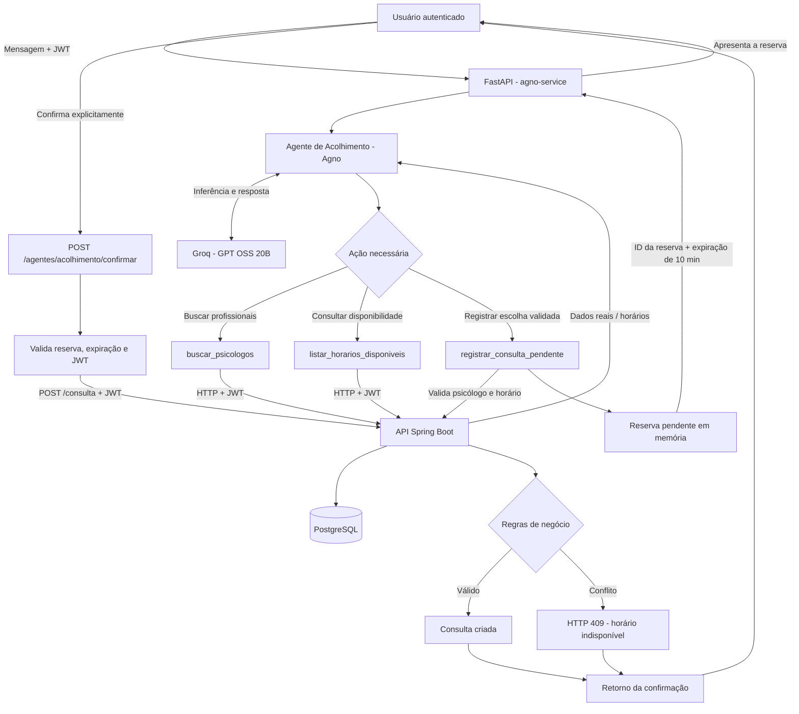

# Mãos Amigas

<p align="center">
  
</p>

Plataforma de apoio psicológico online que conecta pessoas a psicólogos, com agendamento de consultas e um assistente de IA (Groq) que ajuda na busca de profissionais e horários.


---

## Sumário

- [Sobre o projeto](#sobre-o-projeto)
- [Funcionalidades](#funcionalidades)
- [Arquitetura](#arquitetura)
- [Tecnologias](#tecnologias)
- [Estrutura do repositório](#estrutura-do-repositório)
- [Como executar](#como-executar)
- [Variáveis de ambiente](#variáveis-de-ambiente)
- [Autenticação e perfis](#autenticação-e-perfis)
- [Endpoints da API](#endpoints-da-api)
- [Assistente de IA](#assistente-de-ia)
- [Regras de agendamento](#regras-de-agendamento)
- [Documentação e testes manuais](#documentação-e-testes-manuais)
- [Segurança e privacidade](#segurança-e-privacidade)
- [Melhorias futuras](#melhorias-futuras)
- [Autor](#autor)

---

## Sobre o projeto

O **Mãos Amigas** facilita o acesso ao suporte psicológico: o usuário consulta psicólogos cadastrados, agenda consultas online e pode conversar com um assistente de IA que usa dados reais da plataforma (profissionais e horários) para orientar o agendamento.

> A IA é um recurso de apoio à navegação e ao agendamento. Ela **não** faz diagnósticos, não prescreve tratamentos e não substitui o acompanhamento de um psicólogo.

Este repositório contém o **backend** (API REST em Spring Boot) e o **serviço de IA** (FastAPI + Agno). O frontend (React + Vite) fica em um repositório separado.

## Funcionalidades

**Usuários e autenticação**
- Cadastro de usuários (`/auth/register`) e login por e-mail e senha (`/auth/login`).
- Senhas protegidas com BCrypt.
- Tokens JWT assinados com par de chaves RSA.
- Authorization Server OAuth2 embutido, com grant customizado de senha (`/oauth2/token`).
- Perfis `ROLE_ADMIN` e `ROLE_USUARIO`.

**Psicólogos**
- Listagem e busca por id para usuários autenticados.
- Cadastro, atualização e remoção restritos a administradores.
- Dados do profissional: nome, CRP (único) e especialidade.

**Consultas**
- Criação de consulta informando psicólogo, data, horário e observação.
- Listagem das próprias consultas (administradores veem todas).
- Cancelamento (`PATCH /consulta/{id}/cancelar`).
- Status: `AGENDADA`, `CONFIRMADA`, `CANCELADA`, `CONCLUIDA`.
- Validação de dia útil, expediente, horário no passado e conflito de horário, com bloqueio pessimista do psicólogo para evitar agendamentos simultâneos.

**Rede de apoio**
- Cadastro e consulta de organizações de apoio (nome, contato e endereço). Escrita restrita a administradores.

**Assistente de IA**
- Chat com a Groq integrado à API, com consulta a psicólogos e horários reais.
- Serviço de acolhimento em Python (Agno) com fluxo de **reserva pendente + confirmação explícita**.

**API**
- Validação de entrada, tratamento centralizado de exceções e documentação OpenAPI/Swagger.

## Arquitetura

```
┌──────────────────────┐
│  Frontend (React)    │  repositório separado
└──────────┬───────────┘
           │ HTTP + JWT
           ▼
┌──────────────────────┐        ┌──────────────────────────┐
│  API Spring Boot     │◄───────│  agno-service (FastAPI)  │
│  :8080               │  HTTP  │  :8000                   │
│  - Auth / OAuth2     │  + JWT │  - Agente de acolhimento │
│  - Consultas         │        │  - Reserva pendente      │
│  - Psicólogos        │        └────────────┬─────────────┘
│  - /ia (Groq)        │                     │
└───────┬──────────┬───┘                     │
        │          │                         ▼
        ▼          ▼                  ┌──────────────┐
┌─────────────┐  ┌───────────────┐    │   Groq API   │
│ PostgreSQL  │  │   Groq API    │    └──────────────┘
└─────────────┘  └───────────────┘
```

O `agno-service` não acessa o banco: ele repassa o JWT do usuário e chama a API Spring (`/psicologos`, `/ia/ferramentas/horarios`, `/consulta`), então todas as regras e permissões continuam sendo aplicadas no backend.

## Tecnologias

| Camada | Tecnologias |
|---|---|
| Backend | Java 24, Spring Boot 4.1, Spring Web MVC, Spring Data JPA/Hibernate, Bean Validation, Maven Wrapper |
| Segurança | Spring Security, OAuth2 Authorization Server, OAuth2 Resource Server (JWT), BCrypt |
| Banco | PostgreSQL 17 |
| IA | Groq API, WebClient (Spring WebFlux), Agno, FastAPI, Uvicorn |
| Documentação | springdoc-openapi (Swagger UI), coleções Postman |
| Infra | Docker, Docker Compose |

## Estrutura do repositório

```
Maos-Amigas/
├── src/main/java/com/ottoluis/MaosAmigas/
│   ├── config/          # Authorization Server, Resource Server, OpenAPI, WebClient, grant customizado
│   ├── controller/      # Endpoints REST
│   ├── services/        # Regras de negócio
│   ├── repository/      # Spring Data JPA
│   ├── models/          # Entidades (Usuario, Role, SuportePsicologico, Consulta, RedeDeApoio)
│   ├── dto/ mapper/     # DTOs e conversões
│   ├── exception/       # Exceções e handler global
│   └── ia/              # GroqClient e ferramentas usadas pela IA
├── agno-service/        # Serviço Python (FastAPI + Agno)
│   └── app/
│       ├── main.py      # /agentes/acolhimento e /agentes/acolhimento/confirmar
│       ├── agents/      # Agente de acolhimento
│       ├── tools/       # Ferramentas que chamam a API Spring
│       └── reservations.py
├── postman/             # Coleção e ambiente do Postman
├── REGRAS_DE_NEGOCIO.md # Regras de negócio (RN01–RN54)
├── Dockerfile
├── docker-compose.yml   # PostgreSQL + API
└── pom.xml
```

## Como executar

### Pré-requisitos

- JDK 24
- Docker e Docker Compose
- Python 3.12 (para o `agno-service`)
- Chave de API da Groq: <https://console.groq.com/>
- `openssl` (para gerar as chaves JWT)

### 1. Clonar

```bash
git clone https://github.com/OttoLuis/Maos-Amigas.git
cd Maos-Amigas
```

### 2. Gerar as chaves JWT

A API assina e valida os tokens com um par de chaves RSA (caminhos padrão em `.secrets/`, que está no `.gitignore`):

```bash
mkdir -p .secrets
openssl genpkey -algorithm RSA -pkeyopt rsa_keygen_bits:2048 -out .secrets/jwt-private.pem
openssl rsa -pubout -in .secrets/jwt-private.pem -out .secrets/jwt-public.pem
```

### 3. Configurar variáveis

Crie seu arquivo local a partir do exemplo e informe uma senha para o PostgreSQL e sua chave Groq:

```bash
cp .env.example .env
```

Edite o arquivo `.env` e preencha `POSTGRES_PASSWORD` e `GROQ_API_KEY`. Não versione o arquivo `.env`; ele contém credenciais.

### 4. Gerar o jar e subir com Docker

O `Dockerfile` copia `target/*.jar`, então o build do Maven vem antes:

```bash
./mvnw clean package -DskipTests
docker compose up -d --build
```

Serviços iniciados:

| Serviço | Porta |
|---|---|
| API Spring Boot | `8080` |
| Serviço Agno (FastAPI) | `8000` |
| PostgreSQL | `5434` (mapeada para a `5432` do container) |

Comandos úteis:

```bash
docker compose ps
docker compose logs -f app
docker compose down
```

### 5. Executar a API sem Docker (opcional)

Com o PostgreSQL rodando e `src/main/resources/application.properties` configurado (arquivo ignorado pelo Git):

```bash
./mvnw spring-boot:run
```

### 6. Executar o serviço de IA (agno-service)

```bash
cd agno-service
python -m venv .venv
source .venv/bin/activate
pip install -r requirements.txt

cat > .env <<'EOF'
GROQ_API_KEY=sua_chave_da_groq
# Opcionais
# GROQ_MODEL=openai/gpt-oss-20b
# SPRING_API_HOST=127.0.0.1
# SPRING_API_PORT=8080
EOF

uvicorn app.main:app --port 8000 --reload
```

### 7. Frontend

O frontend React + Vite está em repositório separado. Configure nele as URLs das duas APIs:

```env
VITE_API_URL=http://localhost:8080
VITE_AGNO_API_URL=http://localhost:8000
```

O chat utiliza o serviço Agno; as demais funcionalidades continuam consumindo a API Spring Boot.

## Variáveis de ambiente

**API Spring Boot**

| Propriedade / variável | Descrição |
|---|---|
| `SPRING_DATASOURCE_URL` | URL JDBC do PostgreSQL |
| `SPRING_DATASOURCE_USERNAME` / `SPRING_DATASOURCE_PASSWORD` | Credenciais do banco |
| `GROQ_API_KEY` | Chave da Groq (`groq.api.key`) |
| `groq.api.url` / `groq.model` | Endpoint e modelo da Groq |
| `CLIENT_ID` / `CLIENT_SECRET` | Cliente OAuth2 usado em `/oauth2/token` (`security.client-id`, `security.client-secret`) |
| `JWT_DURATION` | Duração do token em segundos (`security.jwt.duration`) |
| `security.jwt.private-key-path` / `public-key-path` | Caminho das chaves (padrão `.secrets/jwt-private.pem` e `.secrets/jwt-public.pem`) |
| `CORS_ORIGINS` | Origens permitidas, separadas por vírgula (`cors.origins`) |

**agno-service**

| Variável | Descrição |
|---|---|
| `GROQ_API_KEY` | Obrigatória |
| `GROQ_MODEL` | Modelo (padrão `openai/gpt-oss-20b`) |
| `SPRING_API_HOST` / `SPRING_API_PORT` | Endereço da API Spring (no Compose: `app:8080`) |
| `AGNO_CORS_ORIGINS` | Origens do frontend permitidas pelo serviço Agno (separadas por vírgula) |

> Nunca versione chaves, senhas ou o diretório `.secrets/`. Troque a senha de exemplo do `docker-compose.yml` e as credenciais `myclientid`/`myclientsecret` fora de ambiente de desenvolvimento.

## Autenticação e perfis

Há duas formas de obter um token JWT:

**1. Login simples**

```bash
curl -X POST http://localhost:8080/auth/login \
  -H "Content-Type: application/json" \
  -d '{"email": "usuario@email.com", "senha": "suasenha"}'
```

**2. OAuth2 (grant de senha customizado)**

```bash
curl -X POST http://localhost:8080/oauth2/token \
  -u myclientid:myclientsecret \
  -d "grant_type=password&username=usuario@email.com&password=suasenha"
```

Use o token nas demais requisições:

```
Authorization: Bearer <access_token>
```

| Perfil | Permissões |
|---|---|
| `ROLE_USUARIO` | Consultar psicólogos, criar/consultar/cancelar as próprias consultas, usar a IA |
| `ROLE_ADMIN` | Tudo acima, ver todas as consultas e gerenciar psicólogos, rede de apoio e usuários |

## Endpoints da API

Rotas públicas: `/auth/login`, `/auth/register` e a documentação Swagger. Todas as demais exigem JWT.

| Método | Rota | Acesso | Descrição |
|---|---|---|---|
| POST | `/auth/register` | Público | Cadastra usuário |
| POST | `/auth/login` | Público | Gera token JWT |
| POST | `/oauth2/token` | Cliente OAuth2 | Gera token (grant de senha) |
| GET | `/usuarios`, `/usuarios/{id}` | Autenticado | Consulta usuários |
| POST/PUT/DELETE | `/usuarios[/{id}]` | Admin | Gerencia usuários |
| GET | `/psicologos`, `/psicologos/{id}` | Autenticado | Lista/busca psicólogos |
| POST/PUT/DELETE | `/psicologos[/{id}]` | Admin | Gerencia psicólogos |
| GET | `/consulta`, `/consulta/{id}` | Usuário/Admin | Lista/busca consultas (usuário vê as suas) |
| POST | `/consulta` | Usuário/Admin | Agenda consulta |
| PATCH | `/consulta/{id}/cancelar` | Usuário/Admin | Cancela consulta |
| GET | `/apoio`, `/apoio/{id}` | Autenticado | Consulta rede de apoio |
| POST/PUT/DELETE | `/apoio[/{id}]` | Admin | Gerencia rede de apoio |
| POST | `/ia/chat` | Autenticado | Conversa com o assistente (Groq) |
| GET | `/ia/ferramentas/horarios?psicologoId=&data=` | Usuário/Admin | Horários livres de um psicólogo na data |

**Serviço de IA (`agno-service`, porta 8000)**

| Método | Rota | Descrição |
|---|---|---|
| POST | `/agentes/acolhimento` | Envia mensagem ao agente (`{"mensagem": "..."}`); pode retornar `reserva_pendente` |
| POST | `/agentes/acolhimento/confirmar` | Confirma uma reserva pendente (`{"reserva_id": "<uuid>"}`) e cria a consulta na API |

## Assistente de IA

O projeto tem duas integrações com a Groq:

- **Chat na API Spring** (`/ia/chat`): `GroqClient` com uso de ferramentas para consultar psicólogos e horários reais.
- **Agente de acolhimento** (`agno-service`): agente Agno com as ferramentas `buscar_psicologos`, `listar_horarios_disponiveis` e `registrar_consulta_pendente`.

Fluxo de agendamento pelo agente:

1. O usuário pede para agendar; o agente consulta psicólogos e horários reais.
2. Quando o usuário escolhe psicólogo, data e horário, o agente registra uma **reserva pendente** (expira em 10 minutos).
3. A consulta só é criada quando o usuário confirma em `/agentes/acolhimento/confirmar`, que chama `POST /consulta` na API com o JWT do próprio usuário.
4. A API reaplica todas as validações; conflitos retornam `409`.

### Diagrama do fluxo Agno + Groq + Spring Boot

O diagrama abaixo detalha a interação entre o usuário, o agente Agno, as ferramentas (Tool Calling) e a API Spring Boot durante a consulta de profissionais e o agendamento:



**Responsabilidades de cada camada:**

- **Agno:** interpreta a mensagem e decide quando utilizar as ferramentas disponíveis.
- **Groq:** fornece o modelo de linguagem utilizado pelo agente.
- **Tools:** consultam psicólogos, verificam horários e solicitam a criação de uma reserva pendente.
- **FastAPI:** recebe as requisições autenticadas, mantém a reserva temporária e controla a confirmação explícita.
- **Spring Boot:** é responsável pelas regras de negócio, autenticação/autorização e criação definitiva da consulta.
- **PostgreSQL:** armazena os dados persistentes da plataforma.

**Proteção contra conflitos:** a consulta de horários feita pelo agente é informativa. No momento da confirmação, o Spring Boot valida novamente a disponibilidade e aplica suas regras transacionais. Se o horário já estiver ocupado, a API retorna `409 Conflict`.


Diretrizes do agente: não inventar profissionais ou horários, não confirmar agendamento sozinho, não diagnosticar nem prescrever, e orientar para serviços de emergência (SAMU 192, Polícia 190) e CVV (188) em situações de risco.

> As reservas pendentes ficam em memória no `agno-service`: são perdidas se o serviço reiniciar e não funcionam com mais de uma instância.

## Regras de agendamento

- Duração fixa de **50 minutos** por consulta.
- Atendimento de **segunda a sexta, das 08h às 18h** (a consulta deve terminar até as 18h).
- Não é possível agendar no passado.
- Um psicólogo não pode ter duas consultas sobrepostas (consultas `CANCELADA` não bloqueiam o horário).
- Toda consulta nasce com status `AGENDADA`.

O conjunto completo de regras está em [`REGRAS_DE_NEGOCIO.md`](REGRAS_DE_NEGOCIO.md).

## Documentação e testes manuais

- **Swagger UI:** <http://localhost:8080/swagger-ui/index.html>
- **Postman:** a pasta [`postman/`](postman) traz a coleção `MaosAmigas` (token, GETs e POSTs) e o ambiente `MaosAmigas`. O script da requisição de token salva o `access_token` na variável `token`.
- **Especificação funcional:** [`src/main/java/com/ottoluis/docs/specs/001-Agendamento-Consulta`](src/main/java/com/ottoluis/docs/specs/001-Agendamento-Consulta) (spec, plano e tarefas do agendamento).

Testes automatizados: há apenas o teste de contexto da aplicação (`MaosAmigasApplicationTests`).

```bash
./mvnw test
```

## Segurança e privacidade

- Autenticação por JWT (RSA) e autorização por perfil com `@PreAuthorize`.
- Senhas com hash BCrypt; segredos fora do código (variáveis de ambiente e `.secrets/`).
- CORS restrito às origens configuradas.
- O assistente de IA recebe apenas o necessário para a tarefa; por se tratar de saúde mental, evite enviar dados pessoais ou sensíveis à Groq sem justificativa e controles de privacidade, e considere as obrigações da LGPD.

## Melhorias futuras

- Testes automatizados para serviços e controllers.
- Migrações versionadas com Flyway (os scripts SQL existem, mas hoje o schema é gerado pelo Hibernate).
- Gestão de disponibilidade por psicólogo.
- Persistência das reservas pendentes (por exemplo, Redis) e do histórico de conversas da IA.
- Link de atendimento online gerado e exibido ao usuário.
- Monitoramento, logs estruturados e CI/CD.

## Autor

**Otto Luis** — [github.com/OttoLuis](https://github.com/OttoLuis)
